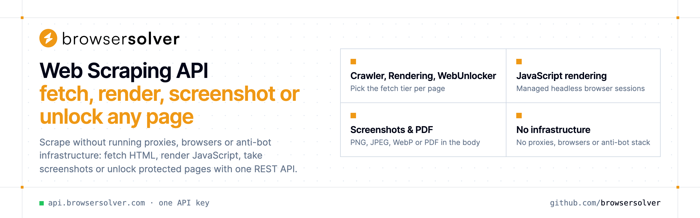

<p align="center">
  <a href="https://www.browsersolver.com"></a>
</p>

<p align="center">

[](https://discord.gg/CFj3ph8aHU) [](https://www.browsersolver.com) [](https://app.browsersolver.com/register) [](https://app.browsersolver.com/openapi)

</p>

**BrowserSolver** is a **web scraping API** with several fetch tiers: a fast HTTP **Crawler**, a headless-browser **Rendering** tier for JavaScript pages and a **WebUnlocker** tier for hosts protected by persistent bot challenges. The same API takes **screenshots** (PNG, JPEG, WebP, PDF), detects the **anti-bot vendor** in front of a site and maps its **technology stack**.

### Why BrowserSolver?

- **Three fetch tiers** — Crawler for static HTML, Rendering for JavaScript pages, WebUnlocker for hosts that still challenge a headless browser.
- **Know before you fetch** — the Antibot endpoint names the bot-protection vendor in front of a URL so you can choose the right tier.
- **Screenshots as a service** — PNG, JPEG, WebP or PDF, full page, 18 device presets, cookie banner and ad removal, S3 upload.
- **Technology detection** — CMS, frameworks, analytics, CDN and security tooling of any public URL.
- **Copy-paste examples** — Python and TypeScript in each README, 7 more languages in `examples/`.

```bash
curl -G https://api.browsersolver.com/v1/website/crawler \
  -H "x-api-key: $BROWSERSOLVER_API_KEY" \
  --data-urlencode "query=https://books.toscrape.com/"
```

### Repositories

- [**Antibot Detection API**](https://github.com/browsersolver/antibot-detection-api) — Find out which bot protection sits in front of a site
- [**JavaScript Rendering API**](https://github.com/browsersolver/javascript-rendering-api) — Get the HTML of JavaScript pages after scripts finish
- [**Screenshot API**](https://github.com/browsersolver/screenshot-api) — Turn any URL into a PNG, JPEG, WebP or PDF
- [**Web Crawler API**](https://github.com/browsersolver/web-crawler-api) — Fast HTML fetch over plain HTTP, no browser needed
- [**Web Unlocker API**](https://github.com/browsersolver/web-unlocker-api) — Fetch pages that still block headless browsers
- [**Website Technology API**](https://github.com/browsersolver/website-technology-api) — Detect the CMS, frameworks, analytics and CDN of any site

---

💬 [Discord](https://discord.gg/CFj3ph8aHU) · 📚 [API reference](https://app.browsersolver.com/openapi) · 🔑 [Get your API key](https://app.browsersolver.com/register) · 🌐 [www.browsersolver.com](https://www.browsersolver.com)
